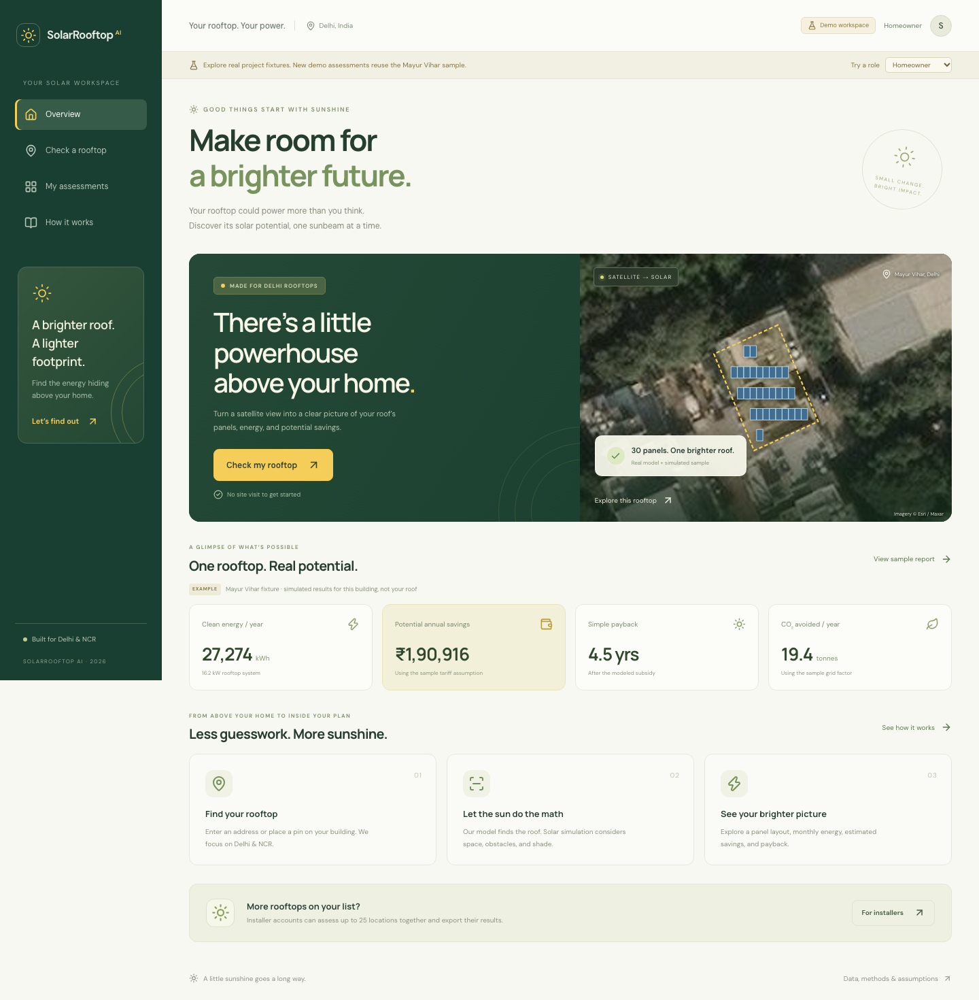
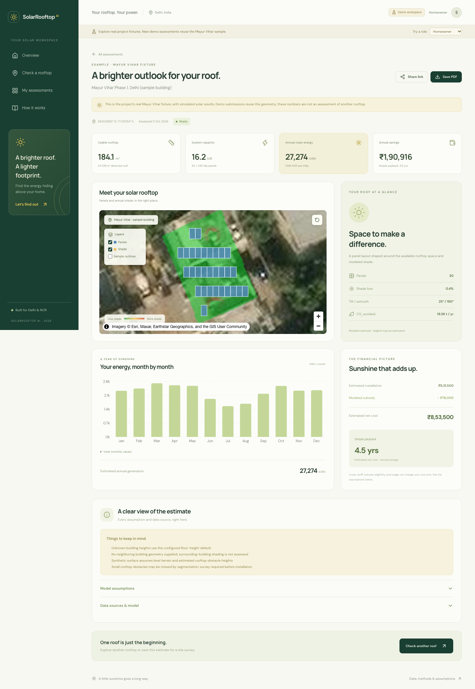

# SolarRooftop AI · frontend

P4’s React workspace for the existing Delhi rooftop pipeline. Warm ivory, deep green, and solar yellow frame real satellite imagery, panel geometry, and solar estimates. All financial and energy values come from contract C.

## Run locally

Use Node 22.12+ (or Node 24/26) and npm. From the repository root:

```bash
cd web
npm ci
npm run dev
```

Open **http://localhost:5173**. `npm run dev` now launches the real local job API and GUI together. It fetches a centered satellite tile and Overture footprints for the selected coordinates, runs the supplied SegFormer checkpoint, then runs P2's shading/panel/energy/finance simulation with PVGIS weather. Each submitted rooftop gets its own imagery, geometry and report. The initial pin and the separate public Sample report are Mayur Vihar; move the pin or enter other coordinates for a fresh scan.

If this workspace is already running, `npm run dev` prints its link and exits successfully without starting another model/API process. Open the existing link. To restart, stop the original launcher with Ctrl+C first; if Codex started it, ask Codex to stop its running session. A different/demo/live server using port 5173 gets a clear port-conflict message and is left running. If only a healthy local API is already running, the launcher connects the GUI to it and leaves that API's lifecycle with its original process.

The prepared `ml/.venv` and checkpoint must exist. For another checkout, follow [the ML setup guide](../ml/README.md) and install the solar dependencies into the same environment:

```bash
uv pip install --python ml/.venv/bin/python \
  -r ml/requirements.txt -r ml/serve/requirements-serve.txt -r solar/requirements-dev.txt "botocore[crt]"
```

Run that installation command from the repo root. This Mac's project-local `uv` is `data/tools/bootstrap/bin/uv`. No separate server on port 8080 is needed for the GUI: the local API loads the model itself. Local settings live in [local/config.json](local/config.json); job data, imagery, heatmaps and weather caches persist under git-ignored `data/local/`. Stop with **Ctrl+C**, which stops both GUI and API. Interrupted jobs are marked failed on the next start; completed reports remain available.

Local scanning supports the existing Delhi/NCR bounds (28.4–28.9 N, 76.8–77.4 E). Enter coordinates to move the map, confirm the pin is on a roof, then select **Find my solar potential**. A location with no detected roof returns a useful failure instead of substituting sample results. Installer CSV batches use the same real pipeline and run one job at a time on this Mac.

Address lookup uses the existing Amazon Location Service adapter when AWS credentials are available (`botocore[crt]` is needed for credentials from `aws login`; if credentials can't be loaded, the local API prints why and starts with address lookup off). Without them, Address is disabled and map pins / `lat,lng` CSV rows work. Internet access is needed for imagery, footprints and uncached weather. The local API binds only to `127.0.0.1:8765` and is a personal development workspace. Production continues to enforce Cognito/Cedar in AWS.

## Fixture demo

Use `npm run dev:demo` for the original MSW demo. Configure `web/.env.development` below with `VITE_USE_MOCKS=true`. Choose Homeowner or Installer in the demo banner. Demo jobs deliberately reuse Mayur Vihar and make no AWS assessment requests; changing the submitted location does not change their sample report. The normal `npm run dev` command overrides the demo setting and never falls back to fixtures.

```text
VITE_USE_MOCKS=true
VITE_API_URL=<API URL from docs/HANDOFF_P4.md>
VITE_USER_POOL_ID=<Cognito pool ID from the handoff>
VITE_USER_POOL_CLIENT_ID=<Cognito client ID from the handoff>
VITE_REGION=ap-south-1
```

The demo and AWS environment files have been configured for this checkout. For a fresh checkout, obtain the non-secret connection values from [the P3 handoff](../docs/HANDOFF_P4.md). Keep all `.env*` files ignored. The normal local GUI needs no Cognito/API environment file.

## Use the real backend

Set the same connection values in `web/.env.production`, with `VITE_USE_MOCKS=false`, then run:

```bash
npm run dev:live
```

This starts Vite with production-mode configuration at **http://localhost:5173**, the backend’s currently allowed CORS origin. Stop the local GUI first to release that port. Cognito’s Authenticator supports sign-in, sign-up, email confirmation, and password recovery. New users are Homeowners; P3 promotes Installer accounts. Sign out and back in after promotion. AWS roles come from the ID token; the demo/local workspace selectors do not change AWS permissions.

Production builds use `.env.production` or Amplify’s environment variables. Missing live configuration displays a setup error; it never silently falls back to mock jobs.

## What is connected

| Screen | Behavior |
| --- | --- |
| Overview | Solar-themed introduction and an explicitly labeled real fixture preview |
| Check a rooftop | Map click / draggable pin, editable coordinates, roof confirmation, or backend-geocoded free-text address |
| Assessment | `POST /jobs`, followed by 3-second status polling through the pipeline stages |
| Report | Contract-C validation, panel GeoJSON, aligned shade image, layer toggles, KPIs, monthly chart and accessible values, finance, assumptions, warnings, and sources |
| My assessments | `GET /jobs`, search/status filters, report links, CSV export |
| Installer workspace | CSV file/paste intake, coordinates or quoted addresses, batch validation, `POST /jobs/batch`, live status table, CSV export |
| Save PDF | Browser print/save-as-PDF with a report stylesheet and expanded assumption data |
| Share link | Copies the current URL; live reports retain account ownership and are not public |

Finished reports refresh every 12 minutes and on focus, obtaining fresh 15-minute signed heatmap links. Failed jobs stop polling; failed network requests have bounded retries. A cold start is not treated as a frontend timeout. Null payback and zero-panel results remain valid.

The API has no address autocomplete or pre-assessment geocode route. The address option submits directly to the backend; the pin option provides exact location confirmation. Live C reports contain no roof/obstacle outlines, so those are available only as labeled sample-fixture layers. `/advisor` is not implemented upstream and has no pretend chat UI.

## Contracts and assets

```bash
npm run generate:types
```

Generates A/B/C TypeScript declarations from `contracts/schemas/`. The generator normalizes draft-2020-12 tuples **in memory only** for the TypeScript generator. AJV validates reports using the unchanged original C schema. Shared contracts are not modified.

`predev` and `prebuild` synchronize the sample satellite and shade images from `contracts/fixtures/`. The hero uses the actual fixture panel geometry. Imagery attribution is visible; fonts are self-hosted.

## Checks

```bash
npm test
npm run build
npx playwright install chromium webkit
npm run test:e2e
SOLAR_E2E_LOCAL=true npm run test:e2e
```

The default browser tests cover demo flows in desktop Chromium and iPhone-sized WebKit: reports/layers, pin validation, progress/history, installer batches/exports and access restrictions. `SOLAR_E2E_LOCAL=true` performs actual scans and batches through the trained model and solar engine, requiring the model environment and provider network access; it creates local jobs, not AWS jobs. Screenshots go to `web/docs/screenshots/`. If the local GUI is already running, run demo/production checks with `SOLAR_E2E_PORT=5174` to keep them separate. Device emulation is not a physical-phone test.

To check the built production sign-in and sample screens on macOS/Linux:

```bash
SOLAR_E2E_PRODUCTION=true npm run test:e2e
```

An authenticated AWS round trip still requires an existing Cognito account. A rendered sign-in screen is not evidence of successful live login or job execution.

## Amplify handoff to P3

The root [amplify.yml](../amplify.yml) configures the `web/` monorepo app: `npm ci`, `npm run build`, `dist/`. Set the VITE values in Amplify, with `VITE_USE_MOCKS=false`. Use a supported Node version. Add the SPA rewrite from [the P4 brief](../P4_Frontend_Product.md#5-amplify-hosting) so `/jobs/:id` and other direct links resolve to `index.html`.

P3 must add the deployed Amplify origin to API and heatmap-bucket CORS and enable an Installer test account. No AWS deployment, account promotion, commit, or push is performed by this frontend implementation.

## Preview




